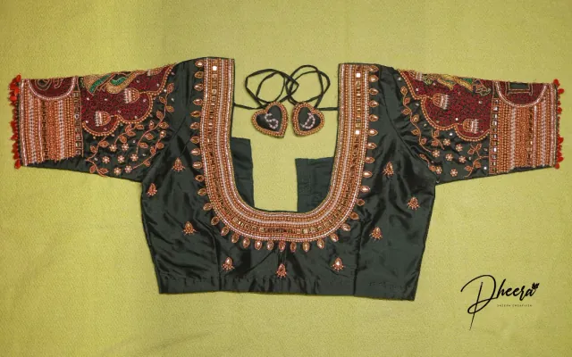

# Dheera Creatives - Website

A premium, responsive website for Dheera Creatives, a handcrafted Aari embroidery and custom stitching brand.

## Project Overview

This website showcases handcrafted Aari embroidery, custom blouse designs, and personalized stitching services. Built with vanilla HTML5, CSS3, and JavaScript, the site focuses on elegance, craftsmanship, and converting visitors into custom order enquiries.

## Features

- Responsive design (desktop, tablet, mobile)
- Premium hero section with floating credibility cards
- Product/collection gallery
- Full photo gallery (24 images) with a keyboard-accessible lightbox and per-photo WhatsApp enquiry
- About, Process, Testimonials, FAQ sections
- Contact and enquiry functionality
- Dynamic configuration via config.js
- SEO optimized with meta tags, robots.txt, sitemap.xml
- Accessible design with proper ARIA attributes

## Tech Stack

- HTML5 (Semantic)
- CSS3 (Custom Properties, Flexbox, CSS Grid)
- Vanilla JavaScript (ES6+)
- No frameworks or build systems

## Project Structure

```
dheera_creatives_demo1/
├── index.html          # Main HTML file
├── styles.css          # All styles
├── script.js           # Interactive functionality
├── config.js           # Centralized configuration
├── robots.txt          # SEO robots file
├── sitemap.xml         # SEO sitemap
├── manifest.json       # PWA manifest
├── assets/
│   ├── aari-embroidery-hero.webp         # Unused legacy hero (900x675, 4:3)
│   ├── aari-embroidery-about.webp        # About section image (810x675, 6:5)
│   ├── aari-embroidery-contact.webp      # Contact card image (900x563, 16:10)
│   ├── embroidery/                       # Full gallery photos + 640px previews
│   │   ├── aari-embroidery-design-01.webp ... -24.webp   # full size (lightbox)
│   │   └── thumbs/
│   │       └── aari-embroidery-design-01.webp ... -24.webp  # grid previews (640px)
│   ├── products/                         # Collection card images (720x540, 4:3)
│   │   └── aari-embroidery-collection-1.webp ... -6.webp
│   ├── logo/                             # Brand logo variations
│   │   ├── primary-horizontal.jpg        # Used in the site header
│   │   ├── secondary-stacked.jpg         # Supplied master artwork
│   │   ├── secondary-stacked-trimmed.jpg # Used in the footer (trimmed)
│   │   ├── wordmark.jpg                  # Reserved (not currently placed)
│   │   ├── favicon.png                   # Source for the icon set (round, transparent)
│   │   └── og-image.jpg                  # Social share image (1200x630)
│   └── icons/                            # Generated favicon / PWA icons (round)
│       ├── favicon.ico                   # 16 / 32 / 48
│       ├── favicon-16.png                # round, transparent corners
│       ├── favicon-32.png                # round, transparent corners
│       ├── favicon-48.png                # round (also embedded in the .ico)
│       ├── apple-touch-icon.png          # 180x180, opaque square (iOS needs this)
│       ├── icon-192.png                  # PWA, round
│       └── icon-512.png                  # PWA, round
└── README.md           # This file
```

> `assets/logo.svg` and `assets/favicon.svg` are earlier placeholder marks that are no
> longer referenced now that the real brand artwork is in place. They are safe to delete.

## How to Update

### Brand Logo
The header and footer logo artwork is **JPEG**, so those files carry an opaque light
background (sampled at `#f4f3f1` for the header mark and `#f1f3f0` for the footer mark).
Placing that straight onto the dark evergreen header or footer would show a light
rectangle, so each logo sits on a `.logo-plate` — a rounded panel whose background colour
matches the artwork, making the logo read as a deliberate chip.

`.logo-plate` uses `#f2f1ef`, which sits within 2/255 of both artwork backgrounds — a
difference that is not perceptible. (The favicon source is separate: it is a **PNG** with a
genuine transparent background, so it needs no plate at all.)

Logo paths live in `config.js` under `client.logo`:

| Key | File | Placed in |
| --- | --- | --- |
| `header` | `assets/logo/primary-horizontal.jpg` | Site header |
| `footer` | `assets/logo/secondary-stacked-trimmed.jpg` | Footer brand column |
| `wordmark` | `assets/logo/wordmark.jpg` | Reserved, not currently placed |

Notes:

- The header `` in `index.html` carries the same path as a fallback, so the logo
  still appears if `config.js` fails to load.
- `secondary-stacked-trimmed.jpg` was produced from the supplied
  `secondary-stacked.jpg` by removing its large empty canvas (the artwork occupied
  946×598 of a 1080×1080 square) and downscaling to 480px wide. The original is kept.
- **If you replace the footer logo**, update the `width`/`height` attributes in
  `footerBrandMark()` in `script.js` to match the new file, otherwise the browser
  reserves the wrong space and the layout shifts as the image loads.
- **If you replace the header logo**, update the `width`/`height` attributes on
  `` in `index.html` to the new file's real pixel size, otherwise
  the browser reserves the wrong aspect ratio and the layout shifts as the image loads.
- Icon files in `assets/icons/` were generated from `assets/logo/favicon.png`.
- **Naming rule:** keep logo filenames lowercase-with-hyphens. Spaces, parentheses and
  capitals (`Primary (Horizontal).jpg`) break on case-sensitive hosts and need
  URL-encoding, which is why the artwork is stored as `primary-horizontal.jpg`.

**Ideally, ask your designer for SVG (or transparent PNG) versions of the logo.** With
transparency the plates can be removed entirely and the logo will sit directly on the
dark header and footer:

```css
.logo-plate { background: transparent; padding: 0; }
```

### Favicon
`assets/icons/` is generated from `assets/logo/favicon.png`. That artwork is **already a
circle on a transparent canvas** (the visible mark fills an inscribed circle; the corners
are fully transparent), so the icon set simply resizes it — no synthetic corner rounding
is applied, and the round shape is preserved at every size.

| File | Shape | Why |
| --- | --- | --- |
| `favicon.ico`, `favicon-16/32/48.png` | round, transparent corners | Tab / bookmark icon |
| `icon-192.png`, `icon-512.png` | round, transparent corners | PWA / shortcut icons |
| `apple-touch-icon.png` (180×180) | **opaque square** | iOS composites icon alpha over **black** and applies its own squircle mask, so transparent corners would show up black on the home screen. This one is composited on the disc's own edge colour (`#f2f2f0`), which makes the circle boundary disappear and keeps the tile light. |

> The source file is a **PNG** containing the circular mark. If you re-export it, keep it
> as `favicon.png` and regenerate the set, otherwise `index.html`'s JSON-LD `logo` and the
> manifest will point at a stale file.

Browsers cache favicons extremely aggressively — `chrome://favicon` and the OS icon cache
are sticky. After changing them, clear the icon cache or test in a fresh profile/private
window, otherwise you may still see the previous icon.

### Site domain (`config.js` → `website.url`)
The domain is configured in **one place**, `config.js`:

```js
// config.js
website: {
  url: "https://dheera.digimaraa.in",   // no trailing slash
  ...
}
```

Set to the production origin, `https://dheera.digimaraa.in`. If it is ever left reading
`REPLACE_WITH...`, the script falls back to `window.location.origin`, so any deployed or
previewed copy fills in the correct origin automatically without edits.

**What is config-driven.** The two JSON-LD blocks in `index.html` carry the literal token
`__SITE_URL__`, which `applySiteUrl()` in `script.js` replaces at runtime. Google executes
JavaScript, so it sees the resolved values — search/structured data stays single-source.

**What is hard-coded, and why.** Social crawlers — Facebook, WhatsApp, X, LinkedIn, Slack,
Discord, iMessage — read raw HTML and **never run JavaScript**. A config-driven value is
therefore invisible to them, and no pure-static site can work around that: making it dynamic
would need server-side templating or a build step that rewrites HTML at deploy time, neither
of which exists here (GitHub Pages serves the files as-is). So three spots are literal URLs,
all currently pointing at `https://dheera.digimaraa.in`:

| Where | Value | Note |
|---|---|---|
| `index.html` `og:url` | `https://dheera.digimaraa.in/` | absolute, per Open Graph spec |
| `index.html` `og:image`, `twitter:image` | `https://dheera.digimaraa.in/assets/logo/og-image.jpg` | must be fetchable without JS |
| `sitemap.xml`, `robots.txt` | `https://dheera.digimaraa.in/...` | crawlers read these files directly |

`canonical` avoids the problem entirely: it is the root-relative `href="/"`, which resolves
correctly on any host (production, preview, localhost) and can never go stale.

> ⚠️ **If the domain ever changes**, update `website.url` in `config.js` **plus** the four
> hard-coded spots above (`og:url`, `og:image` and `twitter:image` in `index.html`, and
> `sitemap.xml` / `robots.txt`). Grep for the old domain to find them all.

### Open Graph preview: "could not load image"

Every share preview fetches the image URL itself. If it reports it could not load:

1. **A crawler once saw a non-public URL.** A common cause is pointing `og:image` at a
   local dev server (`https://127.0.0.1:5500/...` or `http://localhost:...`) — no crawler
   can reach your machine. The URL must be a public `https://` address.
2. **The page URL must be public.** Crawlers cannot reach `localhost`, `file://`, or a
   private/preview deployment. Test against the production URL.
3. **The image URL must be absolute `https://`.** Crawlers do not resolve relative paths.
4. **`og:image` must be a hard-coded absolute URL.** It already is. If it ever
   contains `__SITE_URL__`, non-JS crawlers cannot resolve it — put the absolute URL
   back in `index.html`.
5. **Force a re-scrape.** Platforms cache aggressively — use Facebook's Sharing Debugger
   (Scrape Again), LinkedIn Post Inspector or X's Card Validator. Always clear the
   cached scrape after fixing the URL.

The file itself has been checked and is sound: `assets/logo/og-image.jpg` is a complete
baseline JPEG (not progressive), exactly 1200×630, sRGB, EXIF orientation 1, no ICC
profile, ending in a valid EOI marker. No known crawler rejects those characteristics.

### Update Hero Image
1. Replace `assets/embroidery/aari-embroidery-design-15.webp` with your own Aari embroidery image
2. Use a legitimate, non-watermarked image (own photography or a licensed/properly attributed source)
3. The hero frame is **4:5 portrait** (`.hero-image-wrapper` in `styles.css`). A differently
   shaped photo still works — `object-fit: cover` crops it to the slot — but a 4:5 source
   shows uncropped
4. Update the `width`/`height` attributes on the hero `` in `index.html` to the new
   file's real pixel dimensions so the layout reserves the right space before load

The hero `` is the **only** place the hero photo is referenced, and the surrounding
comment in `index.html` marks the location for quick editing. The now-unused legacy file
`assets/aari-embroidery-hero.webp` can be deleted.

### Gallery and lightbox
The gallery section (`#gallery`) shows **24 photos** in a masonry-style column layout.
It intentionally does **not** use a fixed-ratio grid: the supplied photos mix 4:5 portrait,
16:10 landscape and 9:16 frames, and columns keep every photo at its true aspect ratio
rather than cropping them into one shape.

Each gallery entry is a plain link to the full-size image:

```html
<a class="gallery-item" href="assets/embroidery/aari-embroidery-design-01.webp">
    
</a>
```

Why it is built this way:

- The grid loads only the **640px preview** in `thumbs/` (≈1.6 MB for all 24, far less in
  practice because `loading="lazy"` defers everything below the fold).
- The `href` points at the **full-size** photo, so the link still works — and stays
  crawlable — with JavaScript disabled.
- `width`/`height` on every `` reserves the correct box so the masonry does not
  reflow as photos load.

`initGallery()` in `script.js` intercepts a plain left-click and opens the photo in a
lightbox instead. Modifier-clicks (Ctrl/Cmd/middle) and JavaScript-disabled visitors keep
the normal link behaviour. The lightbox supports:

- **Esc** to close, **← / →** to browse, **Tab** is trapped inside the dialog
- Focus returns to the thumbnail you opened it from
- Swipe left/right on touch devices
- Page scroll is locked while open

#### "Enquire Now" → WhatsApp
The lightbox button pre-fills a WhatsApp chat with the photo you are looking at:

```
https://wa.me/<number>?text=<pre-filled message>
```

- The number comes from `client.whatsapp` in `config.js`.
- The message text comes from `enquiry.whatsappMessage`. `{image}` is replaced at click
  time with the **absolute URL** of the current photo, so the brand can see which design
  the enquiry refers to.
- If `client.whatsapp` is empty, the button falls back to the client's Instagram DM rather
  than becoming a dead link.

> ⚠️ **WhatsApp cannot attach a file from a link.** Click-to-chat (`wa.me`) only pre-fills
> *text* — there is no way for a static site to attach the actual image file. The photo is
> therefore sent as a **link** inside the message. For the link to be useful (and for
> WhatsApp to render a preview thumbnail) the site must be **deployed at its public domain**
> — `website.url` in `config.js` must be the real domain. It is set to
> `https://dheera.digimaraa.in`.
> A truly attached image would require the WhatsApp Business API and a backend, which this
> static site does not have.

> ⚠️⚠️ **The WhatsApp number is currently DigiMaraa's, not the client's.** `client.whatsapp`
> in `config.js` is set to the developer's number as a temporary stand-in so the demo button
> works. **Replace it with Dheera Creatives' own WhatsApp number before launch**, otherwise
> every customer enquiry will go to the developer instead of the brand.

#### Swapping the photos
The 24 photos, their previews and the nine slot images (hero, about, contact, six collection
cards) were produced by a resize/crop pass over the supplied images. To change the set:

1. Put the new source photos in `assets/embroidery/`.
2. Re-run that asset pass to regenerate the numbered files and `thumbs/`.
3. Re-generate the 24 `<a class="gallery-item">` blocks in `index.html` — they are plain,
   static markup, so the numbering, `width`/`height` and `alt` must match the new files.
4. Update the shadowed copies in `assets/products/` and the three slot images at the
   `assets/` root if the slot crops change too.

#### Alt text
Alt text is currently **accurate but generic** — “Handcrafted Aari embroidery by Dheera
Creatives, gallery image N” — because the photo contents were not described when they were
supplied. Nothing is fabricated, but it is also not keyword-rich. If you want stronger image
SEO, send a one-line description for each photo and the `alt` values (and ideally the
filenames) can be made specific.

### Asset inventory
| Asset | Purpose | Notes |
| --- | --- | --- |
| `assets/embroidery/aari-embroidery-design-01..24.webp` | Gallery, full size | Loaded by the lightbox only |
| `assets/embroidery/thumbs/*.webp` | Gallery grid previews | 640px wide, what the page actually loads |
| `assets/embroidery/aari-embroidery-design-15.webp` | Hero image | 1080×1350, shown in a 4:5 frame |
| `assets/aari-embroidery-hero.webp` | Unused legacy hero | 4:3 crop; kept for reference, no longer referenced |
| `assets/aari-embroidery-about.webp` | "Crafted with Passion" image | 6:5 crop |
| `assets/aari-embroidery-contact.webp` | Dheera Creatives contact card | 16:10 crop |
| `assets/products/aari-embroidery-collection-1..6.webp` | Collection cards 1–6 | 4:3 crops |
| `assets/testimonials/` | Empty — add authentic customer photos here | |
| `assets/process/` | Empty — reserved for future real assets | |

> The hero, about, contact and collection images are **crops of photos that also appear in the
> gallery**, not separate photographs. They are deliberately stored at slot-specific sizes so
> each loads only as much data as it displays.

Placeholder review content is clearly labelled in the testimonials section. Replace it with
verified customer feedback before launch.

### Update Contact Information
All contact details live in `config.js` and are rendered by `script.js`. Nothing is hardcoded
in `index.html` (the values present in the HTML are non-authoritative fallbacks shown only if
JavaScript is disabled). Editing `config.js` updates:

- The Instagram link used by every CTA
- The DigiMaraa address, phone and email links in the contact section
- The enquiry form recipient
- The footer, including the dynamic copyright year and the development credit
- The document `<title>` and meta description

### Enquiry Form Configuration
The on-page enquiry form at `#contact` has **no backend**. On submit it validates the fields
in the browser and opens a pre-filled email draft in the visitor's own mail app using a
`mailto:` link. Nothing is transmitted or stored by this website.

The gallery lightbox (`#gallery`) takes a different path: its "Enquire Now" button opens a
WhatsApp chat pre-filled with the photo that the visitor is looking at. See
[Gallery and lightbox](#gallery-and-lightbox) for details.

The email recipient is resolved in this order from `config.js`:

1. `enquiry.recipientEmail` — if set to a non-empty address
2. `agency.newBusinessEmail` — the default fallback
3. `agency.enquiriesEmail`

To send enquiries somewhere else, set `enquiry.recipientEmail` in `config.js`:

```js
enquiry: {
  recipientEmail: "orders@example.com",
  subjectPrefix: "Custom Order Enquiry",
  whatsappMessage: "Hi Dheera Creatives! I would like to enquire about this design: {image}"
}
```

**Important limitation:** a `mailto:` form depends on the visitor having a mail client
configured. If real server-side delivery is required later, the form should be connected to a
form-handling service or backend endpoint and this README updated accordingly.

### Customization
- Colors: edit the CSS custom properties in the `:root` block of `styles.css`
- Typography: update the Google Fonts link in `index.html` (system fallbacks are already defined)
- Content: edit copy directly in `index.html`

### SEO / Deployment Configuration
The domain is configured in **`config.js`**:

```js
website: {
  url: "https://dheera.digimaraa.in",   // no trailing slash
  ...
}
```

Current production origin: **https://dheera.digimaraa.in**.

**Config-driven (JSON-LD).** The two JSON-LD blocks in `index.html` contain the token
`__SITE_URL__`, substituted at runtime by `applySiteUrl()` in `script.js`. Google executes
JavaScript, so it sees the resolved values. If `website.url` is unset, the browser's own
origin is used, so the site works correctly on any host automatically.

**Hard-coded (everything a non-JS crawler needs).** Social crawlers do not execute
JavaScript, so these must be literal absolute URLs in the served HTML:

| File | Where | Current value |
| --- | --- | --- |
| `index.html` | `og:url` | `https://dheera.digimaraa.in/` |
| `index.html` | `og:image`, `twitter:image` | `https://dheera.digimaraa.in/assets/logo/og-image.jpg` |
| `sitemap.xml` | the `<loc>` entry | `https://dheera.digimaraa.in/` |
| `robots.txt` | the `Sitemap:` line | `https://dheera.digimaraa.in/sitemap.xml` |

`canonical` is deliberately root-relative (`href="/"`) so it is correct on any host without
needing a domain at all.

> ⚠️ **Changing the domain** means editing `config.js` **and** the four URLs in the table
> above. A pure-static site cannot make the og/twitter tags dynamic — that would require a
> build step or server-side templating.

The Open Graph / Twitter image **must** be an absolute URL — crawlers do not resolve
relative paths. `assets/logo/og-image.jpg` is already 1200×630, the exact ratio required.

### Placeholder Assets To Replace
There are no placeholder **images** left: the hero, about, contact and collection slots all
use the supplied embroidery photographs, and the gallery shows all 24 of them. See
[Asset inventory](#asset-inventory) for the full list.

What still needs real content before launch:

| Item | Where |
| --- | --- |
| Customer testimonials | `index.html`, testimonials section (currently labelled placeholder copy) |
| WhatsApp number | `config.js` → `client.whatsapp` (currently the developer's number) |
| Final domain | `config.js` → `website.url`, plus `sitemap.xml` and `robots.txt` |
| `assets/testimonials/` | Empty — add authentic customer photos here |


## Development

To run locally, simply open `index.html` in a web browser. No server or build step required.

## Credits

Website developed by DigiMaraa Technologies (https://digimaraa.com)

## License

All rights reserved by Dheera Creatives and DigiMaraa Technologies.